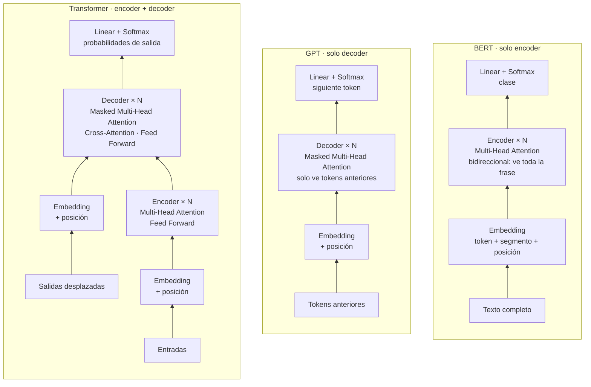
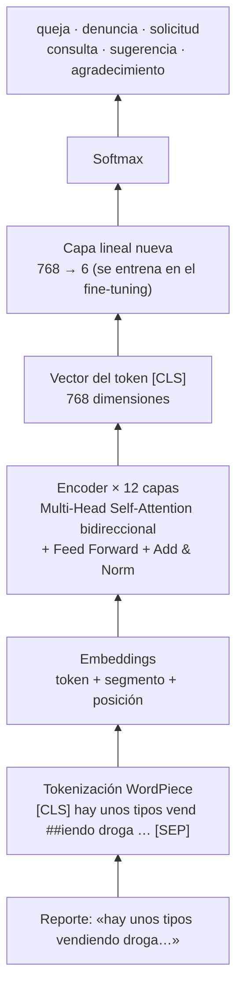
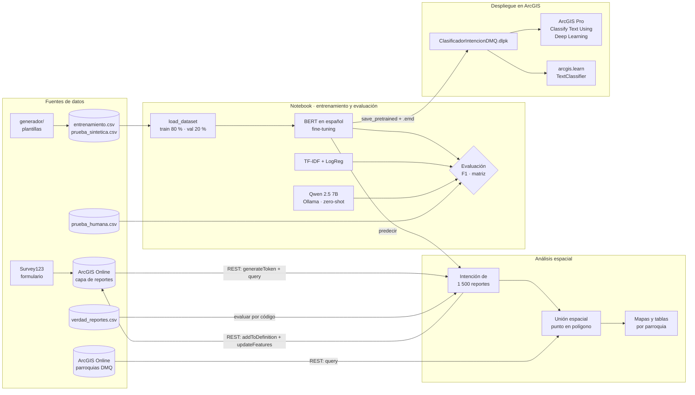
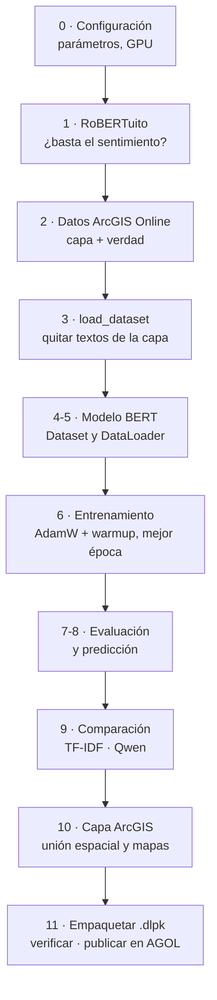
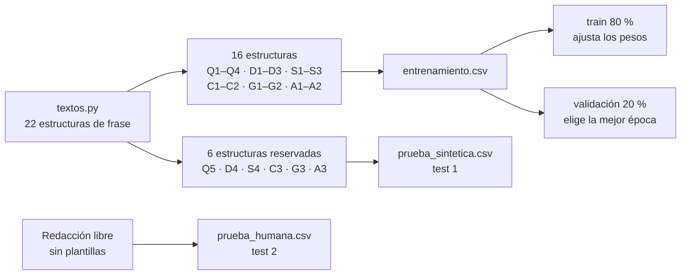
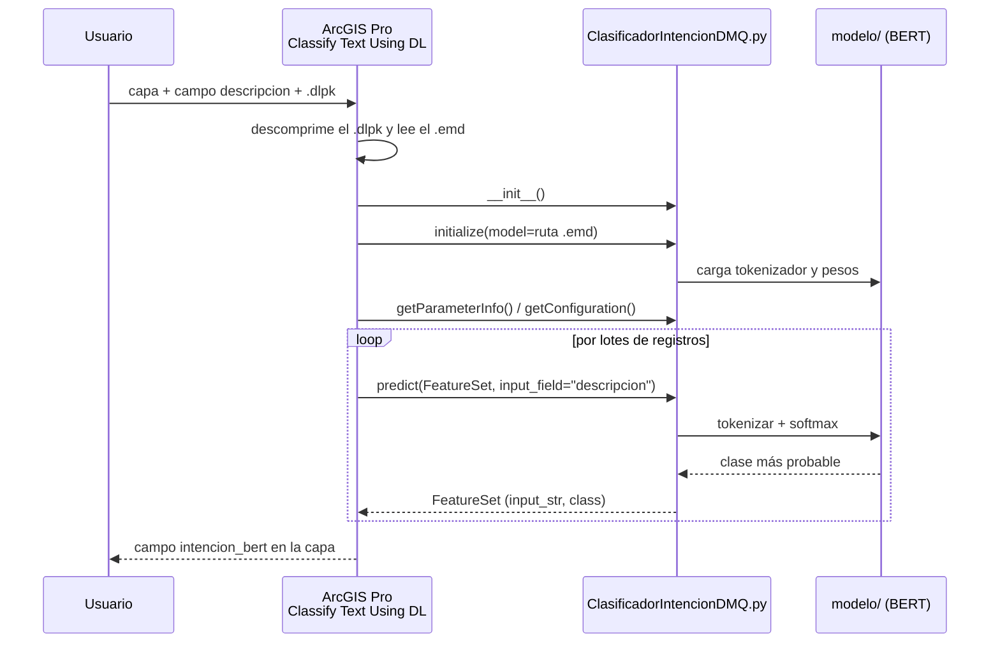

<p align="center">
     
   </p>

# Clasificación de intención en reportes ciudadanos con BERT (Clasificador de texto)

**Universidad San Francisco de Quito** · Colegio de Posgrado<br>
Maestría en Ciencia de Datos · Módulo: Analítica Avanzada


BERT en español ajustado para leer el texto de un reporte ciudadano de Quito y decir **qué pide** quien lo escribió: `queja`, `denuncia`, `solicitud`, `consulta`, `sugerencia` o `agradecimiento`. El modelo se evalúa sobre una capa real de **ArcGIS Online** (formulario Survey123 con 1 500 reportes en las 65 parroquias del DMQ) y se despliega en **ArcGIS** como paquete de deep learning (`.dlpk`).

---

## Contenido

1. [Problema](#1-problema)
2. [Resultados](#2-resultados)
3. [Estructura del repositorio](#3-estructura-del-repositorio)
4. [Datos](#4-datos)
5. [Metodología](#5-metodología)
6. [Cómo ejecutarlo](#6-cómo-ejecutarlo)
7. [Despliegue en ArcGIS](#7-despliegue-en-arcgis)
8. [Limitaciones y trabajo futuro](#8-limitaciones-y-trabajo-futuro)
9. [Fuentes](#9-fuentes)

---

## 1. Problema

Cada reporte de Survey123 queda como un punto en ArcGIS Online con su **categoría** (`vias`, `basura`, `seguridad`…), su **gravedad** y un **texto libre** (`descripcion`). La capa dice qué problema hay y dónde, pero no qué quiere el ciudadano, y eso cambia la respuesta del Municipio:

| Texto | Categoría | Intención | Respuesta |
|---|---|---|---|
| *"Anoche asaltaron a una señora en la parada, ya van tres este mes"* | seguridad | **denuncia** | control policial |
| *"¿Hay algún plan para poner más patrullajes en el barrio?"* | seguridad | **consulta** | comunicación |
| *"Gracias por arreglar el alumbrado tan rápido"* | alumbrado | **agradecimiento** | gestión que funcionó |

Un modelo de **sentimiento** no basta: una queja y una denuncia son igual de negativas (sección 1 del notebook). Hace falta un clasificador de **intención**.

**Preguntas**

1. ¿Cuánto mejora BERT ajustado frente a una línea base clásica (TF-IDF + regresión logística) y frente a un SLM generativo sin entrenar (Qwen 2.5 7B)?
2. ¿Cuánto cae el desempeño con textos escritos por personas frente a textos sintéticos?
3. ¿Qué patrones espaciales aparecen al clasificar los reportes de la capa?
4. ¿Se puede llevar el modelo a ArcGIS, donde viven los datos?

---

## 2. Resultados

Corrida en una GPU NVIDIA RTX PRO 500 Blackwell (6 GB). Entrenamiento de BERT: 4 épocas en **0,9 minutos**.

| Modelo | F1 prueba sintética | F1 prueba humana | ms por texto | Tiempo para 1 500 reportes |
|---|---|---|---|---|
| TF-IDF + regresión logística | 0,82 | 0,57 | 0,2 | 0,3 s |
| **BERT ajustado** | **0,997** | 0,77 | 1,9 | **3 s** |
| Qwen 2.5 7B *zero-shot* | 0,79 ¹ | **0,86** | 1 135 | 28 min |

¹ Muestra de 120 textos, por el tiempo de inferencia.

| Sobre la capa de ArcGIS Online | Valor |
|---|---|
| Accuracy / F1 macro de BERT sobre los 1 500 reportes | 1,00 / 1,00 (optimista: mismo generador) |
| Reportes asignados a su parroquia por unión espacial | 100 % (65 parroquias) |
| Parroquia con más denuncias | La Concepción (foco de seguridad simulado) |
| Parroquias con más quejas | Chimbacalle y Quitumbe |
| Parroquia con más agradecimientos | Belisario Quevedo |
| Registros publicados en ArcGIS Online (`intencion_bert`, `confianza_bert`) | 1 500 de 1 500 |
| `.dlpk` (408 MB): predicciones iguales a las del notebook | 100 % |

**Hallazgos**

1. **Sentimiento ≠ intención.** RoBERTuito marcó como NEG la queja, la denuncia y la solicitud de ejemplo.
2. **BERT supera a TF-IDF** en la prueba humana (0,77 vs 0,57): el contexto importa más que las palabras sueltas.
3. **Qwen sin entrenamiento generaliza mejor al texto libre** (0,86), pero es unas 600 veces más lento. BERT es la opción para clasificar a escala; un esquema híbrido (BERT para todo, Qwen solo para casos de baja confianza) combinaría ambas ventajas.
4. **Límite de los datos sintéticos.** BERT pasa de 0,997 a 0,77 entre plantillas y texto libre. La clase más difícil es **denuncia** (recall 0,33): sin la palabra "denuncio", el modelo la confunde con queja.

Figuras generadas en `salidas/`: matrices de confusión, curva de entrenamiento, comparación de modelos y `mapa_intenciones.png` (reportes, % de denuncias y % de agradecimientos por parroquia).

---

## 3. Estructura del repositorio

```
clasificador-intencion-dmq/
├── clasificador_intencion.ipynb      notebook principal (todo el flujo)
├── README.md
├── requirements.txt
├── .env.example                      credenciales de ArcGIS Online (copiar a .env)
├── imgs/
│   └── proyecto.jpg                  imagen descriptiva del proyecto (portada del README)
├── datos/
│   ├── entrenamiento.csv             1 788 textos sintéticos · 16 estructuras de frase
│   ├── prueba_sintetica.csv          593 textos sintéticos · 6 estructuras nunca vistas
│   ├── prueba_humana.csv             36 reportes redactados sin plantillas (con asistencia de IA)
│   ├── verdad_reportes.csv           intención real de cada reporte de la capa (la agregas tú)
│   └── reportes_dmq.csv              copia local de la capa (opcional, si no usas ArcGIS Online)
├── generador/
│   ├── textos.py                     plantillas por intención y vocabulario por categoría
│   └── generar_datos.py              regenera entrenamiento.csv y prueba_sintetica.csv
├── arcgis_dlpk/
│   └── ClasificadorIntencionDMQ.py   función de inferencia del .dlpk (contrato de Esri)
└── salidas/                          se crea al ejecutar (modelo, .dlpk, figuras, CSV)
```

---

## 4. Datos

### 4.1 Capa de reportes (ArcGIS Online)

Formulario de Survey123 publicado como capa de entidades en ArcGIS Online. Los reportes se generaron y cargaron con `scripts/survey123/generar_reportes.py` del proyecto de tesis *geo_agent_system*. Campos: ubicación (punto), categoría, gravedad, descripción, satisfacción, estado, fecha y código. La capa **no tiene parroquia** a propósito: se obtiene con una unión espacial contra la capa de parroquias del DMQ.

Los 1 500 reportes son **simulados con patrones conocidos**: perfiles urbano y rural, tres focos (basura en Quitumbe, seguridad en La Concepción y alcantarillado en Chimbacalle) y estacionalidad de lluvias. El generador decide primero la intención de cada reporte (según su gravedad, su estado y la categoría) y luego escribe el texto a partir de ella, así que la intención se conoce **por construcción**. Esa intención no se subió a la capa: queda en `verdad_reportes.csv`, que solo se usa para evaluar. En un caso real habría que etiquetar a mano una muestra de reportes para validar el modelo.

### 4.2 Conjuntos de entrenamiento y prueba

| Conjunto | Origen | Qué mide |
|---|---|---|
| `entrenamiento.csv` (80 % train · 20 % validación) | Generador, estructuras `Q1–Q4`, `D1–D3`, `S1–S3`, `C1–C2`, `G1–G2`, `A1–A2` | Ajuste |
| `prueba_sintetica.csv` | Generador, estructuras `Q5`, `D4`, `S4`, `C3`, `G3`, `A3` | Generalización a una redacción nueva |
| `prueba_humana.csv` | Redactados sin plantillas, con asistencia de IA | Desempeño con texto libre (aproximación a texto real) |

**Partición por estructura de frase.** Cada texto sintético combina una estructura (por ejemplo, `S4`: *"Requerimos {acción} {lugar}, gracias de antemano"*) con vocabulario de su categoría. Si se partiera al azar, la misma estructura estaría en entrenamiento y prueba, y el modelo aprobaría memorizando frases. Reservar una estructura por intención mide si reconoce la intención en una redacción que nunca vio.

Además, el notebook quita del entrenamiento cualquier texto idéntico a uno de la capa, para que la evaluación sobre ArcGIS no tenga fuga.

Para regenerar los datos con otra semilla o tamaño:

```bash
python generador/generar_datos.py --n-por-clase 400 --seed 7
```

---

## 5. Metodología

### 5.1 Fundamento teórico: Transformer, GPT y BERT

BERT (Devlin et al., 2019) y GPT derivan de la arquitectura **Transformer** (Vaswani et al., 2017), que combina un **encoder** (lee la entrada) y un **decoder** (genera la salida). Cada familia conserva solo una mitad:



*Diagrama elaborado a partir de la comparación de Smith (2024), adaptada de Vaswani et al. (2017).*

| | Transformer | GPT (solo decoder) | BERT (solo encoder) |
|---|---|---|---|
| Atención | Encoder + decoder | **Enmascarada**: cada token ve solo los anteriores | **Bidireccional**: cada token ve toda la frase |
| Preentrenamiento | Traducción | Predecir el siguiente token | *Masked Language Modelling* (15 % de tokens enmascarados) y *Next Sentence Prediction* |
| Uso natural | Traducción | **Generar** texto | **Entender y clasificar** texto |
| En este proyecto | — | **Qwen 2.5 7B** (*zero-shot*) | **BERT en español** (*fine-tuning*) |

La comparación de la sección 2 es, en el fondo, **encoder vs decoder**: el encoder pequeño y ajustado clasifica en 1,9 ms; el decoder grande sin entrenar entiende mejor el texto libre, pero tarda más de un segundo por reporte.

**Cómo clasifica BERT un reporte.** Sobre el BERT preentrenado se agrega una capa lineal nueva (la única sin preentrenar: los pesos `classifier.*` que el notebook marca como *MISSING*) que toma el vector del token `[CLS]`, que resume toda la frase, y lo convierte en seis puntajes. El *fine-tuning* ajusta esa capa y todo el encoder.



### 5.2 Arquitectura de la solución

La solución tiene cuatro bloques: **fuentes** (ArcGIS Online y los conjuntos de texto), **entrenamiento y evaluación** (notebook), **análisis espacial** y **despliegue** en ArcGIS.



**Flujo del notebook, sección por sección:**



**Partición de los datos:**



### 5.3 Relación con el notebook de clase

El notebook sigue la misma estructura del ejemplo de BERT visto en clase:

| Paso de clase | En este proyecto |
|---|---|
| `pipeline("text-classification", "pysentimiento/robertuito-sentiment-analysis")` | Se usa el mismo modelo para mostrar que el sentimiento no distingue intenciones |
| `load_dataset(...)` + división 80/20 con `random.shuffle` | `load_dataset("csv", ...)` con los tres conjuntos, misma división 80/20 |
| `AutoModelForSequenceClassification("dccuchile/bert-base-spanish-wwm-uncased", num_labels=2)` | Mismo BERT, `num_labels=6` con `id2label` / `label2id` |
| `ReviewDataset` + `tokenize_texts` | `ReporteDataset` + `tokenizar` |
| `AdamW` + `get_linear_schedule_with_warmup` + `clip_grad_norm_` | Igual |
| `evaluate` → accuracy, F1 macro, `classification_report` | `evaluar`, más matrices de confusión |
| `predecir` con `softmax` | Igual, con seis clases, confianza y procesamiento en lotes |

**Cambios respecto al ejemplo de clase, y por qué:**

| Cambio | Motivo |
|---|---|
| `shuffle=True` en el `DataLoader` de entrenamiento | En clase estaba en `False`: sin barajar, cada época ve los lotes en el mismo orden |
| 4 épocas, conservando la mejor según F1 de validación | 15 épocas sobreajustan con datos de plantillas; BERT converge en 2-4 |
| Validación cada época | Permite elegir la mejor época y graficar la curva |
| `predecir` en lotes | Clasificar 1 500 textos de una vez agota la memoria |

### 5.4 Comparación

- **TF-IDF + regresión logística** (n-gramas de palabras 1-2 y de caracteres 2-5): si BERT no la supera, no se justifica.
- **Qwen 2.5 7B *zero-shot*** vía Ollama: el SLM de la tesis, con las definiciones de cada intención en el prompt y la salida restringida a un esquema JSON con las seis etiquetas. Mide si un modelo generativo sin entrenamiento resuelve la tarea, y a qué costo de tiempo.

### 5.5 Aplicación espacial

BERT clasifica la `descripcion` de los 1 500 reportes. Cada punto se asigna a su parroquia con una unión espacial punto-en-polígono (respetando huecos) contra la capa pública de parroquias del DMQ, y se calcula la proporción de cada intención por parroquia.

---

## 6. Cómo ejecutarlo

### 6.1 Entorno

```bash
python -m venv .venv                  # Python 3.12 recomendado
.venv\Scripts\activate                # Windows   (Linux/Mac: source .venv/bin/activate)
pip install -r requirements.txt
```

Con GPU NVIDIA, instala antes torch con CUDA. Para GPU Blackwell (serie RTX 50 / RTX PRO) se necesita CUDA 12.8 o superior: `pip install torch --index-url https://download.pytorch.org/whl/cu128`. Comprueba con `python -c "import torch; print(torch.cuda.is_available())"`. Sin GPU funciona igual, más lento.

### 6.2 Datos de la capa

1. Copia `verdad_sentimiento.csv` (salida del generador de la capa) como `datos/verdad_reportes.csv`.
2. Elige de dónde leer los reportes:
   - **ArcGIS Online (recomendado):** copia `.env.example` como `.env` y completa `ARCGIS_USERNAME` y `ARCGIS_PASSWORD`. Si falta la contraseña, el notebook la pide al ejecutarse. El archivo `.env` está en `.gitignore`.
   - **Copia local:** copia `reportes_simulados.csv` como `datos/reportes_dmq.csv` y deja el `.env` vacío.

Las URL de las capas están en la celda de parámetros del notebook (`URL_REPORTES`, `URL_PARROQUIAS`).

### 6.3 SLM para la comparación (opcional)

Abre Ollama y descarga el modelo: `ollama pull qwen2.5:7b`. Si Ollama no está disponible, esa parte se omite y el resto del notebook sigue.

### 6.4 Ejecutar

```bash
jupyter notebook clasificador_intencion.ipynb
```

Ejecuta celda por celda la primera vez. Todo lo configurable está en la celda **Parámetros**.

> Si vuelves a ejecutar la celda que carga BERT (sección 4) después de entrenar, el modelo vuelve a su estado sin entrenar. Para repetir algo, usa **Restart + Run All**.

---

## 7. Despliegue en ArcGIS

El modelo se entrega en el formato nativo de ArcGIS para modelos de IA: un **paquete de deep learning (`.dlpk`)**. Desde ArcGIS Pro 3.4, Esri permite empaquetar **modelos de lenguaje propios** (*third-party language models*) y usarlos en las herramientas de análisis de texto de la caja **GeoAI**.

### 7.1 Contenido del paquete

```
ClasificadorIntencionDMQ.dlpk  (ZIP con este contenido en la raíz)
├── ClasificadorIntencionDMQ.emd   definición del modelo (JSON)
├── ClasificadorIntencionDMQ.py    función de inferencia
└── modelo/                        BERT ajustado (config.json, model.safetensors, tokenizer)
```

**Archivo `.emd`** (lo genera el notebook):

| Clave | Valor | Para qué |
|---|---|---|
| `InferenceFunction` | `ClasificadorIntencionDMQ.py` | Archivo con la clase de inferencia |
| `ModelType` | `TextClassifier` | Tipo de tarea (también existen `SequenceToSequence` y `EntityRecognizer`) |
| `ArcGISLearnVersion` | `2.4.0` | Versión de `arcgis.learn` que soporta funciones NLP propias |
| `OutputField` | `ClassLabel` | Campo de salida |
| `Labels` | las seis intenciones | Clases del modelo |
| `ModelFile` | `modelo` | Carpeta con los pesos; la lee nuestra función `initialize` |

**Función de inferencia** (`arcgis_dlpk/ClasificadorIntencionDMQ.py`). Implementa el contrato que define Esri:

| Método | Qué hace aquí |
|---|---|
| `__init__` | Nombre y descripción del modelo |
| `initialize(**kwargs)` | Lee el `.emd` (`kwargs["model"]`) y carga tokenizador y modelo desde `modelo/` |
| `getParameterInfo()` | Expone `max_length` como argumento del modelo en la herramienta |
| `getConfiguration(**kwargs)` | Recibe `max_length` y `batch_size` elegidos por el usuario |
| `predict(feature_set, **kwargs)` | Lee el campo de texto `kwargs["input_field"]` y devuelve un `FeatureSet` con `input_str` y `class` |

Así lo usa ArcGIS al ejecutar la herramienta:



**Reglas que hay que respetar**, verificadas en el código de `arcgis.learn` 2.4:

- La clase se llama igual que el archivo `.py` (`arcgis.learn` la busca por el nombre del archivo).
- El `.emd` va en la **raíz** del ZIP: así arma los `.dlpk` el propio `arcgis.learn`, y así los busca al abrirlos.
- `predict` debe devolver un `FeatureSet`; si no, `arcgis.learn` lanza un error.

### 7.2 Compatibilidad de versiones

Las librerías de deep learning de ArcGIS Pro traen su propia versión de `transformers` (4.51.3 en el instalador más reciente), y el notebook puede entrenar con `transformers` 5.x. Los tokenizadores guardados con la versión 5 declaran una clase que la 4.x no reconoce. Por eso la función de inferencia carga el tokenizador con `PreTrainedTokenizerFast`, que lee `tokenizer.json` directamente.

Se verificó así:

- **Carga con el código real de Esri:** el `.dlpk` se cargó con el cargador de modelos de texto de `arcgis.learn` 2.4.3 (`TextModelExtension`), con `transformers` 4.51.3 y un `FeatureSet` real. `predict` devolvió un `FeatureSet` válido.
- **Mismas predicciones en ambas versiones:** la tokenización y las probabilidades fueron idénticas entre `transformers` 5.20 y 4.51.3.
- **Mismo resultado que el notebook:** la sección 11.2 del notebook repite la carga del paquete y compara sus predicciones con las del modelo entrenado.

### 7.3 Usarlo en ArcGIS Pro

**Requisitos**

- ArcGIS Pro 3.4 o superior, con licencia **Advanced**. Las licencias educativas de la universidad suelen serlo; revisa la tuya.
- *Deep Learning Libraries Installer for ArcGIS Pro* instalado (trae `torch` y `transformers`).
- GPU opcional: en el entorno de geoprocesamiento, *Processor Type* = GPU.

**Pasos**

1. Agrega la capa de reportes al mapa y expórtala a una geodatabase (*Export Features*). La herramienta agrega un campo y conviene no modificar la capa del formulario.
2. Abre **Geoprocessing → GeoAI → Text Analysis → Classify Text Using Deep Learning**.
3. Completa los parámetros: *Input Table* = la capa exportada · *Text Field* = `descripcion` · *Input Model Definition File* = `ClasificadorIntencionDMQ.dlpk` · *Class Label Field* = `intencion_bert`.
4. Ejecuta. Luego puedes simbolizar por intención o resumir por parroquia con *Summarize Within*.

Desde la ventana de Python de ArcGIS Pro:

```python
import arcpy
arcpy.env.processorType = "GPU"     # o "CPU"
arcpy.geoai.ClassifyTextUsingDeepLearning(
    in_table=r"C:\proyecto\reportes.gdb\reportes_dmq",
    text_field="descripcion",
    in_model_definition_file=r"C:\proyecto\salidas\ClasificadorIntencionDMQ.dlpk",
    class_label_field="intencion_bert",
)
```

Con la API de Python de ArcGIS:

```python
from arcgis.learn.text import TextClassifier
modelo = TextClassifier.from_model(r"C:\proyecto\salidas\ClasificadorIntencionDMQ.dlpk")
modelo.predict(["Denuncio que botan escombros en la quebrada"]).df
```

> **Seguridad:** un `.dlpk` con función de inferencia ejecuta código Python. Esri recomienda usar solo paquetes de fuentes de confianza.

### 7.4 Publicar las predicciones en ArcGIS Online

Con `ESCRIBIR_EN_ARCGIS = True`, el notebook agrega a la capa de reportes los campos `intencion_bert` y `confianza_bert` y los llena. Usa dos operaciones de la API REST de ArcGIS: **Add To Definition**, en la URL de administración del servicio, y **Update Features**, en lotes de 250. Así el WebMap, un dashboard o el agente geoespacial de la tesis consultan la intención como cualquier otro campo. No modifica ningún otro campo de la capa.

### 7.5 ¿Y MLflow o Docker?

La carpeta `modelo/` es el formato estándar de Hugging Face, así que también podría servirse con el *flavor* `transformers` de MLflow dentro de un contenedor. Se eligió ArcGIS porque es donde viven los datos y los usuarios. Ahí el modelo se ejecuta sobre la capa sin mover datos a otro servicio, y el resultado queda como un campo más del mapa.

---

## 8. Limitaciones y trabajo futuro

- **Datos sintéticos.** La capa y el entrenamiento salen del mismo generador, así que el desempeño sobre la capa es optimista. La métrica creíble es la de la **prueba humana**, que tiene solo 36 textos redactados con asistencia de IA, no por ciudadanos reales: un error mueve el F1 unos 3 puntos, y la ventaja de Qwen sobre BERT equivale a unos 3 textos. Siguiente paso: que 5 a 10 personas escriban reportes, etiquetarlos con dos anotadores y medir el acuerdo (kappa de Cohen).
- **Una etiqueta por texto.** Un reporte que se queja *y* pide algo recibe la intención dominante. Una versión multietiqueta lo resolvería.
- **Solo texto.** El modelo no usa la categoría, la gravedad ni la ubicación.
- **Confianza en ArcGIS Pro.** La función de inferencia devuelve solo los campos documentados por Esri (`input_str`, `class`). La confianza se publica desde el notebook (sección 7.4).
- **Validación perfecta desde la primera época** (F1 = 1,00): otra señal de que los textos de plantilla son fáciles para BERT.
- **Trabajo futuro:** esquema híbrido BERT + Qwen por confianza; más variedad de redacción en las denuncias; ampliar el entrenamiento con paráfrasis generadas por un SLM y con reportes reales etiquetados; integrar el clasificador como herramienta del agente geoespacial de la tesis.

---

## 9. Fuentes

**Esri / ArcGIS**

- [Use third-party language models with ArcGIS (ArcGIS Pro)](https://pro.arcgis.com/en/pro-app/3.5/tool-reference/geoai/using-third-party-language-models-with-arcgis.htm): contrato de la función de inferencia, `.emd` y empaquetado `.dlpk`.
- [Use third party language models with ArcGIS (ArcGIS API for Python)](https://developers.arcgis.com/python/latest/guide/use-third-party-language-models-with-arcgis/): uso con `arcgis.learn.text.TextClassifier.from_model`.
- [Classify Text Using Deep Learning (GeoAI)](https://pro.arcgis.com/en/pro-app/3.5/tool-reference/geoai/classify-text-using-deep-learning.htm): parámetros, licencia Advanced y sintaxis de `arcpy.geoai.ClassifyTextUsingDeepLearning`.
- [Exploring model extensibility for named entity recognition](https://developers.arcgis.com/python/latest/guide/exploring-model-extensibility-for-named-entity-recognition/): ejemplo completo de `.dlpk` con función propia (`ArcGISLearnVersion` 2.4.0).
- [Install deep learning frameworks for ArcGIS](https://doc.esri.com/en/arcgis-pro/latest/help/analysis/deep-learning/install-deep-learning-frameworks.html) y [Esri/deep-learning-frameworks](https://github.com/Esri/deep-learning-frameworks): librerías de deep learning de ArcGIS Pro (versión de `transformers`).
- [Add To Definition (Feature Layer)](https://developers.arcgis.com/rest/services-reference/online/add-to-definition-feature-layer-.htm): agregar campos a una capa alojada.

**BERT y Transformers**

- Devlin, J., Chang, M.-W., Lee, K. y Toutanova, K. (2019). [BERT: Pre-training of Deep Bidirectional Transformers for Language Understanding](https://arxiv.org/abs/1810.04805). *NAACL-HLT*.
- Vaswani, A. et al. (2017). [Attention Is All You Need](https://arxiv.org/abs/1706.03762). *NeurIPS*.
- Smith, B. (2024). [A Complete Guide to BERT with Code](https://towardsdatascience.com/a-complete-guide-to-bert-with-code-9f87602e4a11/). *Towards Data Science*.

**Modelos**

- [BERT en español (dccuchile)](https://github.com/dccuchile/beto) · [`dccuchile/bert-base-spanish-wwm-uncased`](https://huggingface.co/dccuchile/bert-base-spanish-wwm-uncased)
- [`pysentimiento/robertuito-sentiment-analysis`](https://huggingface.co/pysentimiento/robertuito-sentiment-analysis)
- [Qwen2.5](https://ollama.com/library/qwen2.5) vía Ollama